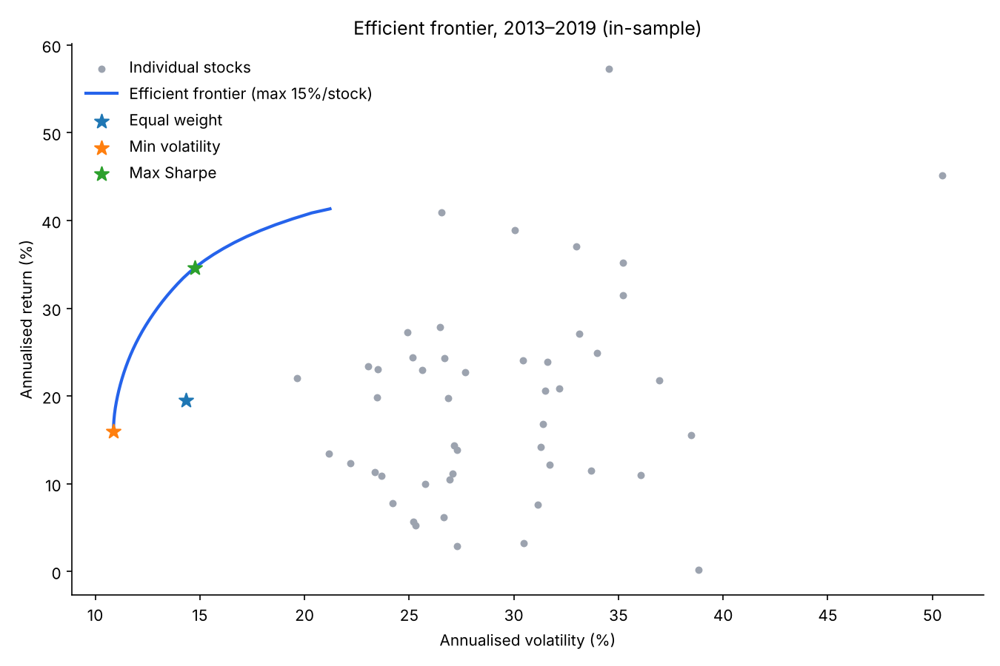
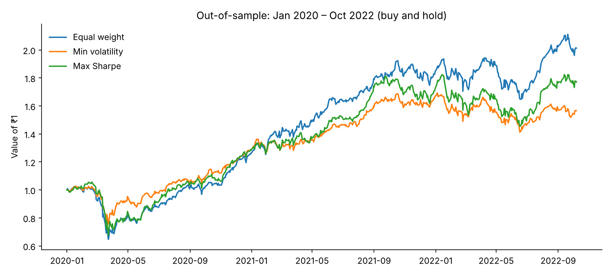
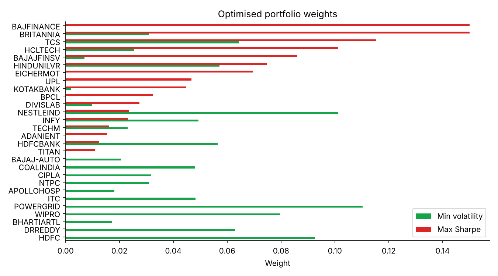

# NIFTY-50 Portfolio Optimizer

Mean-variance portfolio optimisation on NIFTY-50 stocks. It builds long-only portfolios on 2013–2019 prices, then checks how they actually performed on data they never saw (Jan 2020 – Oct 2022, which includes the COVID crash and the recovery).

## What it does

1. Loads daily adjusted prices for the 48 NIFTY-50 stocks listed for the whole period. The data comes from [Ram9219/NIFTY-50-Stock-Market-Data-2000---2022-](https://github.com/Ram9219/NIFTY-50-Stock-Market-Data-2000---2022-) and is downloaded on first run. Three data errors in the source (TATASTEEL's split, a stale stretch of HDFC prices, ADANIENT's demerger) are corrected.
2. Estimates expected returns and the covariance matrix from **2013–2019** only.
3. Solves for three portfolios with SciPy SLSQP: long-only, fully invested, **max 15% in any stock**:
   - **Equal weight** (benchmark)
   - **Min volatility**
   - **Max Sharpe** (6.5% risk-free rate)
4. Traces the efficient frontier.
5. Holds each portfolio from 1 Jan 2020 to 7 Oct 2022 with no rebalancing and measures what happened.

## Results

**In-sample (2013–2019), what the optimiser expected:**

| Portfolio | Return | Volatility | Sharpe |
|---|---|---|---|
| Equal weight | 19.5% | 14.3% | 0.91 |
| Min volatility | 15.9% | 10.9% | 0.87 |
| Max Sharpe | 34.6% | 14.8% | **1.91** |

**Out-of-sample (Jan 2020 – Oct 2022), what actually happened:**

| Portfolio | CAGR | Volatility | Sharpe | Max drawdown | ₹1 became | Holdings |
|---|---|---|---|---|---|---|
| Equal weight | **29.2%** | 22.8% | **0.99** | −36.9% | **₹2.01** | 48 |
| Min volatility | 17.8% | **19.0%** | 0.60 | **−26.2%** | ₹1.57 | 25 |
| Max Sharpe | 23.3% | 23.5% | 0.71 | −36.0% | ₹1.77 | 17 |

**What this shows:** the max-Sharpe portfolio looked twice as good as equal weight on paper, but lost to it once the period changed. Mean-variance optimisation chases past winners, and historical returns are a noisy estimate of future ones. Equal weight is a hard benchmark to beat. Min volatility did its own job: it had the smallest drawdown in the 2020 crash, at the cost of lower returns.





## Run

```bash
pip install -r requirements.txt
python optimizer.py
```

The script writes `outputs/weights.csv`, `outputs/out_of_sample.csv`, `outputs/results.json` and three charts.

## Ideas to extend

- Shrink the covariance estimate (Ledoit-Wolf) and use shrunk or equal expected returns
- Rebalance every quarter on a rolling window
- Add risk parity and Black-Litterman portfolios
